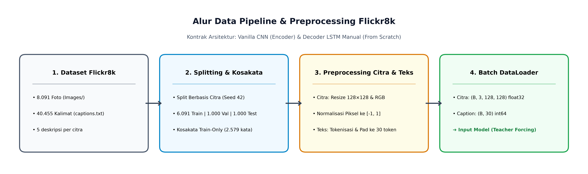
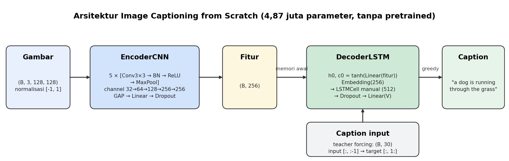
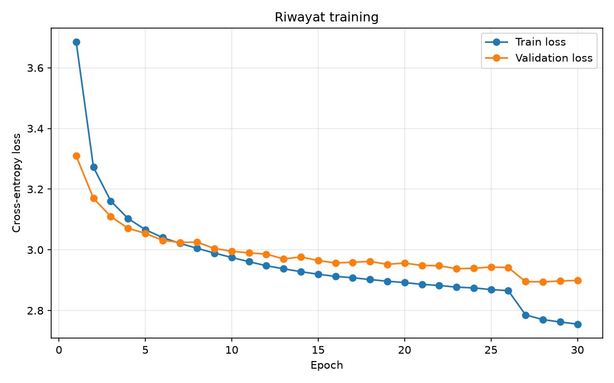
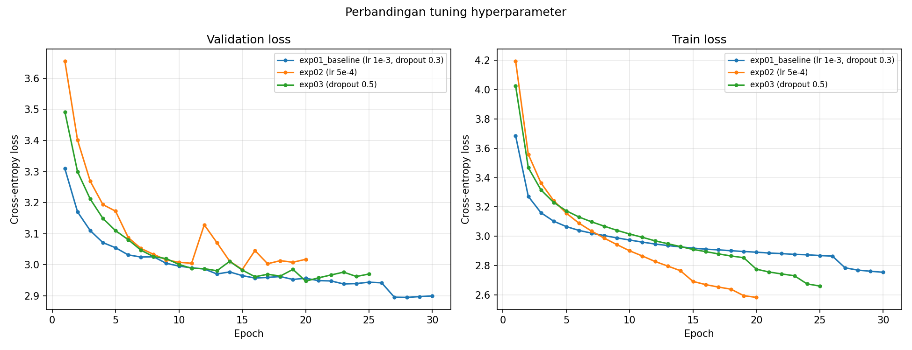
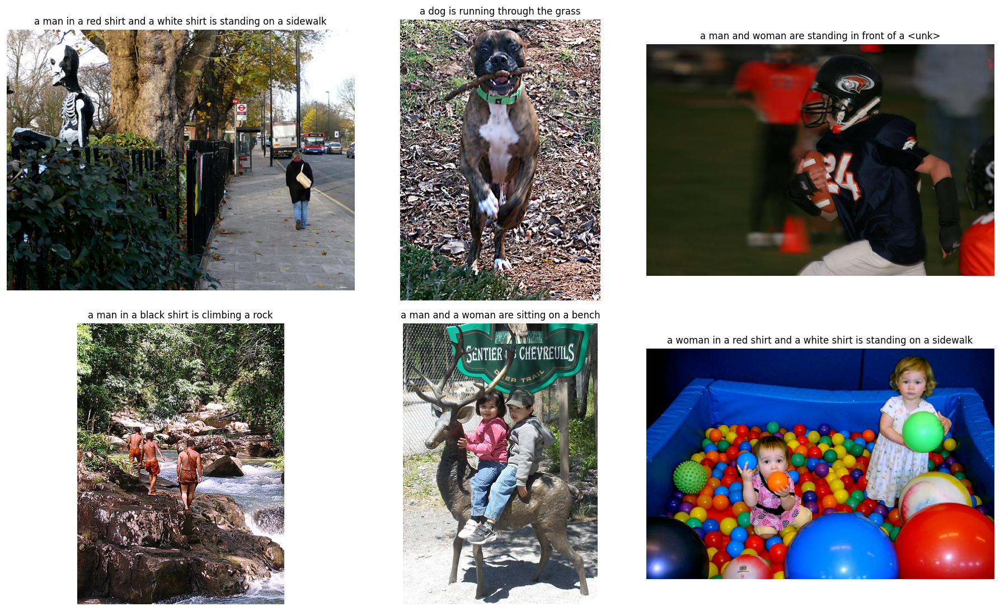

# LAPORAN PROYEK KELOMPOK 1
## Image Captioning from Scratch
### Encoder Vanilla CNN dan Decoder LSTM Manual dengan Metode Vibe Coding

**Mata Kuliah:** Generative AI (CAK4KBB3) - 2026/1  
**Kelompok:** An Tech A Sync  
**Repositori:** [https://github.com/steezym/image-captioning](https://github.com/steezym/image-captioning)  
**Waktu:** Oktober 2026  

| Anggota | Nama | Peran |
|---|---|---|
| 1 (Ketua) | Mazmur Bryan | Prompt Engineer & LLM Navigator, Model |
| 2 | Muhammad Ahsan Raziq Sulthany | Data Pipeline & Preprocessing |
| 3 | Zaidan Daffa Abdillah | Training Loop & Hyperparameter Tuning |
| 4 | Muhammad Mulnawarman | Lead Documentarian & Error Handler |

---

## Ringkasan

Proyek ini membangun model *image captioning* yang menerima sebuah foto dan menghasilkan satu kalimat deskripsi berbahasa Inggris. Seluruh model dibangun dari nol (*from scratch*): encoder berupa Vanilla CNN 5 blok dan decoder berupa LSTM yang sel-nya ditulis manual dari `nn.Linear`, tanpa model *pretrained* dan tanpa `nn.LSTM`. Kode, arsitektur, dan proses *debugging* dikerjakan dengan metode *vibe coding*, yaitu berkolaborasi aktif dengan Large Language Model (Claude dan Codex) dan mendokumentasikan setiap interaksi dalam log.

Model dilatih pada dataset Flickr8k (8.091 gambar, 5 caption per gambar) dengan total 4,87 juta parameter. Model final (exp01) mencapai *validation loss* 2,8945, *test loss* 2,9035, BLEU-1 0,4605, BLEU-4 0,0923, METEOR 0,2962, dan CIDEr 0,3093 pada 1.000 gambar uji. Tiga percobaan *tuning* (*learning rate* dan *dropout*) menunjukkan bahwa *loss* terendah tidak selalu menghasilkan caption terbaik: *learning rate* 5e-4 memberi BLEU-4 tertinggi (0,1048) meskipun lebih cepat *overfitting*. Model juga dikemas dalam aplikasi web sederhana untuk mencoba foto sendiri.

---

## 1. Pendahuluan

### 1.1 Latar Belakang
*Image captioning* adalah tugas lintas domain (multimodal) yang menggabungkan *computer vision* untuk memahami isi gambar dan *natural language processing* untuk menyusun kalimat. Tugas ini dipilih karena memperlihatkan secara jelas bagaimana dua jenis jaringan saraf yang berbeda dapat disambungkan menjadi satu sistem generatif.

### 1.2 Tujuan
1. Membangun model *image captioning* dari nol: arsitektur dirancang sendiri dan bobot dilatih dari acak.
2. Menerapkan *vibe coding*: mengarahkan LLM untuk menghasilkan kode yang bersih dan modular, lalu mendokumentasikan proses inisiasi, *debugging*, dan optimasi.
3. Melatih, mengevaluasi, dan melakukan *tuning* model, serta menyajikan hasilnya dalam metrik yang valid.

### 1.3 Batasan (Aturan *From Scratch*)
- **Dilarang:** model *pretrained* (ResNet, VGG, dan lain-lain), `nn.LSTM`, `nn.LSTMCell`, `nn.RNN`, `nn.GRU`, `nn.Transformer*`, `nn.MultiheadAttention`.
- **Diizinkan:** lapisan dasar PyTorch (`nn.Linear`, `nn.Conv2d`, `nn.BatchNorm2d`, `nn.Embedding`, `nn.Dropout`), fungsi aktivasi, *loss*, *optimizer*, dan `torchvision.transforms`.
- Metrik evaluasi (BLEU, METEOR, CIDEr) juga ditulis sendiri tanpa library seperti `nltk`.

---

## 2. Metode Kerja: Vibe Coding

### 2.1 Alur Kerja
Setiap modul dikerjakan dengan siklus yang sama: anggota memberi arahan lewat *prompt* (diawali *system prompt* bersama yang berisi aturan *from scratch* dan kontrak antarmodul), LLM menulis kode beserta uji kecil, anggota menjalankannya di Google Colab atau laptop, lalu melaporkan hasil atau pesan *error* ke LLM untuk dianalisis dan diperbaiki. Setiap sesi dicatat di `logs/anggotaX/` mengikuti template log dari panduan tugas.

### 2.2 Kontrak Antarmodul
Agar anggota dapat bekerja paralel, ukuran data antarbagian disepakati di awal dan dicatat di README:

| Bagian | Masuk | Keluar |
|---|---|---|
| **Data pipeline** | file gambar + caption | gambar `(B, 3, 128, 128)` dalam $[-1, 1]$; caption `(B, 30)` int64 |
| **EncoderCNN** | gambar `(B, 3, 128, 128)` | fitur `(B, 256)` |
| **DecoderLSTM** | fitur `(B, 256)` + caption `(B, 30)` | logits `(B, 29, vocab_size)` |
| **Training** | logits + caption | loss (cross-entropy, abaikan `<pad>`) |

*Tabel 1. Kontrak antarmodul. Token khusus: `<pad>=0`, `<start>=1`, `<end>=2`, `<unk>=3`.*

### 2.3 Pembagian Tugas dan Kontribusi
Kelompok menerapkan prinsip saling *backup*: jika satu bagian terhambat, anggota lain membantu dan hal itu dicatat secara terbuka.

| Anggota | Tanggung Jawab Utama | Kontribusi di Repositori |
|---|---|---|
| **1 - Mazmur Bryan (Ketua)** | Arsitektur, prompt, integrasi | Setup repo & Colab; EncoderCNN, LSTMCell manual, DecoderLSTM, CaptioningModel; review dan merge PR; backup tuning (exp02, exp03); predict.py dan aplikasi demo; draft laporan |
| **2 – Muhammad Ahsan Raziq Sulthany** | Data pipeline | Pipeline data Flickr8k |
| **3 - Zaidan Daffa Abdillah** | Training & tuning | Pipeline data Flickr8k (`vocab.py`, `dataset.py`) sebagai backup Anggota 2; `train.py`, `evaluate.py`, `metrics.py`; training exp01 (30 epoch) |
| **4 – Muhammad Mulnawarman** | Dokumentasi & error handler | Konsolidasi log interaksi LLM, penyusunan `logs/RINGKASAN_ERROR.md`, dan peninjauan pengujian modul |

*Tabel 2. Pembagian tugas dan kontribusi (riwayat lengkap di commit dan Pull Request GitHub).*

### 2.4 Infrastruktur
- **GitHub:** satu branch per anggota. Semua kode masuk ke `main` lewat *Pull Request* yang ditinjau ketua (PR #1–#8).
- **Google Colab (GPU T4)** dan **laptop dengan GPU (GTX 1660 Ti, RTX 3050)** untuk menjalankan uji dan training.
- **Google Drive** untuk dataset (`archive.zip`) dan checkpoint, karena file besar tidak disimpan di Git.

---

## 3. Dataset dan Preprocessing

| Aspek | Nilai |
|---|---|
| **Sumber** | Flickr8k (Kaggle: `adityajn105/flickr8k`) |
| **Jumlah gambar** | 8.091 gambar, 5 caption per gambar (40.455 caption) |
| **Pembagian (per gambar, seed 42)** | 6.091 train / 1.000 validation / 1.000 test |
| **Kosakata** | 2.579 token (kata dengan frekuensi < 5 di data train menjadi `<unk>`) |
| **Panjang caption** | maksimal 30 token termasuk `<start>` dan `<end>` |
| **Transform gambar** | resize $128 \times 128$, normalisasi $[-1, 1]$; training: ColorJitter ringan tanpa horizontal flip |

*Tabel 3. Ringkasan dataset dan preprocessing.*

Pembagian dilakukan per gambar, bukan per caption, agar gambar yang sama tidak muncul di data latih dan data uji. Kosakata dibangun hanya dari data train untuk mencegah kebocoran data. *Horizontal flip* sengaja tidak dipakai karena caption dapat memuat kata *"left"* atau *"right"* yang akan bertentangan dengan gambar yang dibalik.

  
*Gambar 1. Tahap-tahap preproses.*

---

## 4. Arsitektur Model

  
*Gambar 2. Arsitektur model: encoder CNN meringkas gambar menjadi fitur, decoder LSTM menyusun caption kata demi kata.*

### 4.1 EncoderCNN (Vanilla CNN)

| Blok | Operasi | Ukuran Keluaran |
|---|---|---|
| **Input** | — | `(3, 128, 128)` |
| **1** | Conv 3×3 (3→32), BN, ReLU, MaxPool 2 | `(32, 64, 64)` |
| **2** | Conv 3×3 (32→64), BN, ReLU, MaxPool 2 | `(64, 32, 32)` |
| **3** | Conv 3×3 (64→128), BN, ReLU, MaxPool 2 | `(128, 16, 16)` |
| **4** | Conv 3×3 (128→256), BN, ReLU, MaxPool 2 | `(256, 8, 8)` |
| **5** | Conv 3×3 (256→256), BN, ReLU, MaxPool 2 | `(256, 4, 4)` |
| **Kepala** | Global Average Pooling → Linear(256, 256) → Dropout | `(256)` |

*Tabel 4. Susunan EncoderCNN (1.045.024 parameter).*

Conv memakai `bias=False` karena BatchNorm sesudahnya sudah memiliki parameter geser sendiri. *Global Average Pooling* menghasilkan 256 angka (bukan 4.096 jika di-flatten), sehingga lapisan Linear jauh lebih kecil dan model tidak mudah *overfit*.

### 4.2 LSTMCell Manual
Satu `nn.Linear(input + hidden, 4 × hidden)` menghitung keempat gate sekaligus, lalu hasilnya dipotong menjadi $i, f, g, o$:
- **$i$ (input gate)**, sigmoid: seberapa banyak informasi baru yang dicatat.
- **$f$ (forget gate)**, sigmoid: seberapa banyak memori lama yang disimpan. Bias diinisialisasi 1 agar di awal training memori cenderung dipertahankan.
- **$g$ (candidate)**, tanh: isi informasi baru.
- **$o$ (output gate)**, sigmoid: seberapa banyak memori yang dikeluarkan.

Pembaruan memori: $c' = f \cdot c + i \cdot g$ dan $h' = o \cdot \tanh(c')$. Ketepatan rumus diuji dengan menghitung ulang gate secara terpisah dan membandingkan hasilnya.

### 4.3 DecoderLSTM dan CaptioningModel
- Fitur gambar dijadikan memori awal LSTM: $h_0 = \tanh(\text{Linear}(\text{fitur}))$, $c_0 = \tanh(\text{Linear}(\text{fitur}))$.
- Setiap langkah: `Embedding(256)` $\rightarrow$ `LSTMCell (512)` $\rightarrow$ `Dropout(0,3)` $\rightarrow$ `Linear(vocab_size)` menghasilkan skor untuk setiap kata.
- **Training (*teacher forcing*):** input `caption[:, :-1]`, target `caption[:, 1:]`. Uji khusus membuktikan model tidak "mengintip" kata berikutnya.
- **Inferensi (*greedy search*):** mulai dari `<start>`, kata dengan skor tertinggi menjadi input langkah berikutnya, berhenti di `<end>`.
- Total **4.866.355 parameter** (encoder 1.045.024 + decoder 3.821.331).

Sebelum training penuh, model lulus uji hafalan: dilatih 150 langkah pada 4 pasangan gambar-caption acak, loss turun dari 6,92 ($\approx \ln 1000$, tebakan acak) ke 0,0066 dan keempat caption ditulis ulang dengan tepat. Ini membuktikan aliran data dan gradien tersambung benar dari gambar sampai kalimat.

---

## 5. Training dan Evaluasi

### 5.1 Pengaturan Training

| Komponen | Pengaturan |
|---|---|
| **Loss** | `CrossEntropyLoss(ignore_index=<pad>)` |
| **Optimizer** | Adam, learning rate 1e-3, weight decay 1e-4 |
| **Stabilisasi** | gradient clipping 5,0; ReduceLROnPlateau (patience 2, factor 0,5) |
| **Penghentian** | maksimal 30 epoch, early stopping patience 5 (berdasarkan validation loss) |
| **Batch / seed** | 64 / 42 |
| **Checkpoint** | disimpan setiap epoch (bisa dilanjutkan); `best_model.pt` = validation loss terendah |

*Tabel 5. Pengaturan training (exp01).*

### 5.2 Hasil Training (exp01)

  
*Gambar 3. Kurva train dan validation loss exp01 (30 epoch).*

Kedua loss turun stabil. Validation loss terbaik 2,8945 di epoch 28. Penurunan tajam di epoch 27 terjadi karena scheduler menurunkan learning rate ke 5e-4. Setelah epoch ~7 jarak train dan validation melebar perlahan, tanda awal *overfitting* ringan.

### 5.3 Metrik Evaluasi
Karena keluaran berupa kalimat, akurasi klasifikasi biasa tidak representatif. Model dievaluasi pada 1.000 gambar uji dengan metrik yang ditulis sendiri: BLEU-1 s.d. BLEU-4 (kecocokan rangkaian 1-4 kata), METEOR (kecocokan kata dengan memperhitungkan urutan), dan CIDEr (kemiripan dengan konsensus 5 caption manusia).

| Test loss | BLEU-1 | BLEU-2 | BLEU-3 | BLEU-4 | METEOR | CIDEr |
|---|---|---|---|---|---|---|
| 2,9035 | 0,4605 | 0,2737 | 0,1539 | 0,0923 | 0,2962 | 0,3093 |

*Tabel 6. Hasil evaluasi model final (exp01, checkpoint epoch 28) pada test set.*

---

## 6. Tuning Hyperparameter

Pengaturan yang diuji dipilih dari pola grafik exp01. Setiap percobaan hanya mengubah satu pengaturan agar pengaruhnya jelas; pengaturan lain dan pembagian data tetap sama.

| Percobaan | Perubahan | Alasan |
|---|---|---|
| **exp01 (baseline)** | lr 1e-3, dropout 0,3 | Pembanding |
| **exp02** | learning rate 5e-4 | Validation loss baru turun lagi setelah LR diturunkan scheduler di epoch 27, jadi LR awal mungkin terlalu besar |
| **exp03** | dropout 0,5 | Jarak train-validation melebar setelah epoch ~7, jadi regularisasi lebih kuat mungkin membantu |

*Tabel 7. Rancangan percobaan tuning.*

| Percobaan | Epoch | Terbaik | Val loss | Test loss | BLEU-1 | BLEU-4 | METEOR | CIDEr |
|---|---|---|---|---|---|---|---|---|
| **exp01** | 30 | 28 | **2,8945** | **2,9035** | 0,4605 | 0,0923 | **0,2962** | 0,3093 |
| **exp02 (lr 5e-4)** | 20 (early stop) | 15 | 2,9844 | 3,0091 | 0,4869 | **0,1048** | 0,2938 | **0,3593** |
| **exp03 (dropout 0,5)** | 25 (early stop) | 20 | 2,9468 | 2,9535 | **0,4871** | 0,0994 | 0,2826 | 0,3287 |

*Tabel 8. Hasil tuning (exp02 dan exp03 dijalankan di laptop GPU GTX 1660 Ti).*

  
*Gambar 4. Perbandingan validation loss (kiri) dan train loss (kanan) ketiga percobaan.*

### 6.1 Analisis
1. **exp02 (learning rate lebih kecil)** justru paling cepat *overfitting*. Train loss turun paling jauh (2,58), tetapi validation loss naik-turun sehingga *early stopping* menghentikannya di epoch 20. Hipotesis "LR terlalu besar" tidak terbukti untuk validation loss.
2. **exp03 (dropout 0,5)** paling stabil. Jarak train-validation paling kecil. Dropout lebih besar berhasil menahan *overfitting*.
3. **Loss dan metrik caption tidak sejalan.** exp01 memiliki loss terendah, tetapi exp02 dan exp03 memiliki BLEU dan CIDEr lebih tinggi. Cross-entropy mengukur keyakinan per kata, sedangkan BLEU/CIDEr menilai kalimat utuh hasil *greedy decoding*.
4. Replikasi di Google Colab (GPU berbeda) menghasilkan pola yang sama: exp02 memiliki validation loss tertinggi ($\pm 3,00$) dan exp03 mendekati exp01 ($\pm 2,96$). Perbedaan kecil angka disebabkan sifat acak GPU dan urutan data.
5. **Keputusan model final:** sesuai protokol, model dipilih berdasarkan validation loss, bukan skor test, agar tidak terjadi kebocoran data uji. Maka exp01 menjadi model final, sedangkan exp02 dicatat sebagai pengaturan dengan kualitas caption tertinggi.

---

## 7. Hasil Kualitatif dan Aplikasi Demo

  
*Gambar 5. Caption hasil model (exp02) untuk 6 gambar uji yang tidak pernah dilihat saat training.*

| Caption Model | Caption Manusia | Penilaian |
|---|---|---|
| `a dog is running through the grass` | A brown and white dog is jumping up, with a stick in its mouth | **Objek benar** |
| `a man in a black shirt is climbing a rock` | Three boys walk on rocks along a river | **Objek dan tempat benar** |
| `a man ... is standing on a sidewalk` | A person is walking on a sidewalk ... | **Tempat benar** |
| `a man and a woman are sitting on a bench` | Two children sit on an animal's back | **Kurang tepat** |
| `a woman ... is standing on a sidewalk` | Kids playing in a tub of plastic balls | **Salah** |

*Tabel 9. Contoh hasil yang baik dan yang gagal.*

Model mengenali objek dan tempat yang sering muncul di Flickr8k (anjing, rumput, air, batu, trotoar), tetapi kesulitan pada adegan yang jarang muncul (kolam bola, football). Untuk mencoba foto sendiri, tersedia `src/predict.py` (command line) dan aplikasi web Streamlit (`app.py`): pengguna cukup mengunggah foto dan caption langsung muncul.

---

## 8. Log Interaksi LLM dan Penanganan Error

Log setiap anggota tersimpan di folder `logs/` dengan struktur sesuai panduan: tahap inisiasi (*prompt*, alasan, *output*), penanganan *error* (pesan *error*, *prompt* perbaikan, analisis), dan optimasi. Ringkasan seluruh error ada di `logs/RINGKASAN_ERROR.md`. Beberapa error penting:

| Error | Penyebab | Solusi |
|---|---|---|
| `No module named 'imp'` (Colab) | Python 3.13 menghapus modul `imp` yang dipakai autoreload | Ganti dengan fungsi `muat_ulang()` |
| `No module named tests.test_encoder` | Bentrok dengan paket `tests` bawaan Colab | Tambah `tests/__init__.py` |
| `torch ...+cpu, CUDA False` | PyTorch versi CPU-only terpasang | Pasang ulang wheel CUDA 12.6 (`--force-reinstall`) |
| `Branch tidak bisa di-PR (no common history)` | Branch ditimpa salinan repo lain | Branch bersih dari main, commit dipindah dengan penulis asli |
| `Windows error 1455 di epoch 24` | RAM 7,8 GB habis oleh 4 proses DataLoader | Lanjut dari checkpoint dengan `num_workers 1` |

*Tabel 10. Contoh error dan penyelesaiannya.*

**Pelajaran utama:** membaca baris terakhir traceback dan lokasi file-nya; menguji di lingkungan target (Colab) karena lulus di laptop belum tentu lulus di sana; memeriksa versi PyTorch sebelum training; dan menyimpan checkpoint setiap epoch.

---

## 9. Kesimpulan, Keterbatasan, dan Saran

### 9.1 Kesimpulan
1. Model *image captioning* berhasil dibangun sepenuhnya dari nol (CNN 5 blok + LSTM manual, 4,87 juta parameter) dan menghasilkan caption yang logis untuk adegan umum.
2. Model final mencapai BLEU-1 0,4605, BLEU-4 0,0923, dan CIDEr 0,3093 pada 1.000 gambar uji.
3. *Tuning* menunjukkan dropout 0,5 paling efektif menahan *overfitting*, learning rate 5e-4 memberi caption paling mirip manusia, dan loss terendah tidak selalu berarti caption terbaik.
4. *Vibe coding* memungkinkan kelompok membangun, men-debug, dan mengoptimasi model secara sistematis, dengan setiap keputusan terdokumentasi di log dan riwayat Git.

### 9.2 Keterbatasan
- Encoder dilatih dari nol pada $\pm 6.000$ gambar. Model *pretrained* umumnya belajar dari jutaan gambar.
- Gambar diperkecil ke $128 \times 128$, sehingga detail kecil hilang.
- Fitur gambar hanya menjadi memori awal LSTM, sehingga pada kata-kata berikutnya model cenderung menulis pola umum (misalnya *"a man in a red shirt"*).
- Kosakata terbatas: kata yang jarang menjadi `<unk>`.

### 9.3 Saran Pengembangan
1. *Beam search* menggantikan *greedy search* (tanpa training ulang).
2. Memasukkan fitur gambar di setiap langkah decoder, atau menambahkan mekanisme *attention* pada fitur spasial CNN.
3. Resolusi gambar lebih besar dan dataset lebih besar (Flickr30k atau MS COCO).
4. Memilih model berdasarkan BLEU/CIDEr pada validation set, bukan hanya validation loss.

---

## Lampiran

### A. Struktur Repositori
- `src/`: `encoder.py`, `lstm_cell.py`, `decoder.py`, `model.py`, `vocab.py`, `dataset.py`, `train.py`, `evaluate.py`, `metrics.py`, `predict.py`
- `app.py`: aplikasi web upload foto
- `tests/`: uji setiap modul (pytest)
- `notebooks/`: `colab_runner`, notebook uji Anggota 1 dan 2, `download_dataset`, `anggota1_tuning`
- `results/`: grafik, riwayat training, evaluasi, perbandingan tuning, contoh caption
- `logs/`: log interaksi LLM per anggota dan `RINGKASAN_ERROR.md`

### B. Cara Menjalankan
- **Training:** `python -m src.train --images-dir ... --captions-file ...`
- **Evaluasi:** `python -m src.evaluate --checkpoint best_model.pt`
- **Caption foto:** `python -m src.predict --checkpoint best_model.pt --image foto.jpg`
- **Aplikasi web:** `streamlit run app.py`

### C. Log Interaksi LLM
- **Anggota 1:** `logs/anggota1/` (setup & EncoderCNN, LSTMCell, DecoderLSTM, CaptioningModel, tuning).
- **Anggota 2:** `logs/anggota2/` (data pipeline Flickr8k).
- **Anggota 3:** `logs/anggota3/` (training dan evaluasi).
- **Anggota 4:** `logs/anggota4/` (ringkasan error)
